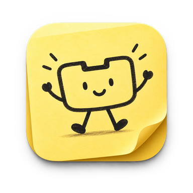

<p align="center">
  
</p>

<h1 align="center">StickyNotch</h1>

<p align="center">
  A tiny, lightweight app that turns your Mac's notch into a little desk:<br>
  music, sticky notes, your clipboard and more, right where you already look.
</p>

<p align="center">
  <a href="https://arsal.me/StickyNotch/"><b>Download for Mac</b></a> · macOS 14+ · Apple Silicon &amp; Intel
</p>

## What it does

Hover over the notch and it opens into a small panel; move away and it tucks itself back in.

- **Music player**: what's playing in Spotify or Apple Music, scrubbing, skip, and which AirPods or speakers it's on. Optional spinning vinyl.
- **Sticky notes**: up to five notes. Lock one to keep the notch open (handy in interviews) and drag it wider when you need room.
- **Clipboard history**: your last 20 copied texts, kept in memory only. Passwords from password managers are skipped.
- **File shelf**: drop files on the notch to park them, preview with Quick Look, drag them out where you need them.
- **Next meeting**: a countdown in the closed notch with a one-click Join for Zoom, Meet, Teams and Webex.
- **Claude Code**: see when Claude is working or done, and Allow / Deny its permission requests from the notch.

It stays out of the way: about 50 MB of memory and ~0% CPU while idle.

## Installing

1. Download the DMG from **[arsal.me/StickyNotch](https://arsal.me/StickyNotch/)** and drag StickyNotch into Applications.
2. StickyNotch isn't signed with an Apple Developer ID yet, so the first time you open it macOS says it can't verify the app. Go to **System Settings → Privacy & Security** and click **Open Anyway**.
3. After that it updates itself (Settings → About → Check for Updates).

## Building from source

Requires Xcode 16 or later.

```bash
git clone https://github.com/arsallls/StickyNotch.git
cd StickyNotch
open boringNotch.xcodeproj   # scheme: boringNotch
```

Or build a release DMG from the command line:

```bash
scripts/build-dmg.sh
```

Release builds that should receive updates need a feed address and the release signing key in your Keychain; see the comments at the top of `scripts/build-dmg.sh`.

## Credits and license

StickyNotch is a fork of **[boring.notch](https://github.com/TheBoredTeam/boring.notch)** by TheBoredTeam. Huge thanks to them for the foundation.

Licensed under the [GNU General Public License v3.0](LICENSE). Third-party components are listed in [THIRD_PARTY_LICENSES](THIRD_PARTY_LICENSES).
